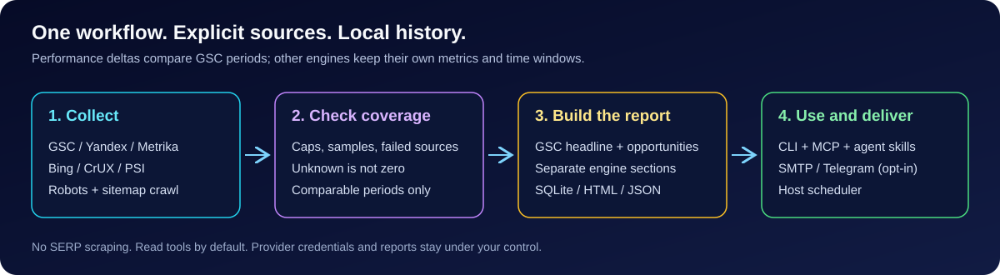

# lv24-seo-optimizer

<!-- mcp-name: io.github.LevapVeeskela/lv24-seo -->

[](https://github.com/LevapVeeskela/lv24-seo-optimizer/actions/workflows/ci.yml)
[](https://pypi.org/project/lv24-seo/)
[](https://www.npmjs.com/package/@lv24/seo)
[](LICENSE)
[](pyproject.toml)

**Free-first SEO control plane for humans and AI agents.**

> **Your site's SEO, without a dashboard.** Pull Search Console, Yandex Webmaster and Metrika, Bing,
> CrUX and your own crawl into one history — then get a weekly diff by email, an MCP server and a CLI
> that agents can actually use. No paid platform, no SERP scraping, no vendor account.

| 🚀 Start | 🧠 Use | 🛠 Operate |
| --- | --- | --- |
| [Install](#install) · [See it work](#see-it-work) · [Docs](#documents) | [CLI](docs/cli.md) · [MCP tools](docs/mcp.md) · [Skills](docs/skills.md) | [Scheduling](docs/scheduling.md) · [Data limits](docs/data-sources.md) · [Security](SECURITY.md) |

One tool that pulls Google Search Console, Yandex Webmaster, Yandex Metrika, Bing Webmaster,
Chrome UX Report and PageSpeed Insights into a single normalized model, crawls your site for
technical SEO regressions, and turns all of it into **scheduled email reports**, **MCP tools**,
**CLI commands** and **agent skills**.

No paid SEO platform required. Everything in the default path has a free tier.

```
┌──────────── data sources (free) ────────────┐      ┌──── surfaces ────┐
│ GSC · Yandex Webmaster · Metrika · Bing ·    │ ───▶ │ CLI (--json)     │
│ CrUX · PSI · your own crawl + nginx logs     │      │ MCP server       │
└──────────────────────────────────────────────┘      │ Skills / AGENTS  │
                                                      │ Email / Telegram │
                                                      │ SQLite history   │
                                                      └──────────────────┘
```



## Why another SEO tool

* **Free-first fusion.** Existing MCP servers wrap one vendor each and hand raw vendor shapes to
  the model. We join GSC + Bing + Yandex + Metrika per property, and we *say out loud* what the
  APIs cannot give you (Yandex has no query×page join, GSC caps at 50k rows/day, data lags 2–3 days).
  Bounded provider responses expose coverage, freshness and limitations; unknown totals stay unknown.
* **Comparable periods.** The headline compares current and previous GSC windows. Yandex,
  Metrika, Bing, CrUX field data and PSI lab data keep separate sections. Opt-in delivery
  applies the configured significance thresholds and skips content already sent for the period.
* **Agent-native.** A small, stable MCP tool surface (read-only by default), a JSON envelope on every
  CLI command, and skills that encode *audit → plan → fix → verify* against a real repository.
* **Zero spend.** Public-repo CI, SQLite storage, SMTP/Telegram delivery, no SaaS in the default path.
  Paid-provider integrations are research/planned work, not dependencies or shipped adapters.

## Status

**Beta (v0.4.0).** Working today: six provider adapters (GSC, Yandex Webmaster, Yandex
Metrika, Bing/IndexNow, CrUX, PSI), a 30-rule crawler, SQLite history, analysis (deltas, opportunities,
indexing triage, multi-engine fusion, nginx log stats), report builders + HTML/text/Markdown renderers,
SMTP/Telegram delivery with idempotency, the full CLI, the MCP server (11 tools, 3 resources,
3 prompts) and scheduler generators. Canonical source ids, GSC-only headline deltas, partial
provider isolation and window/daily storage separation are enforced with regression tests.

Still honest gaps before `v1.0`: GSC service-account auth (OAuth token only today),
sitemap submit / Yandex recrawl return an explicit `WRITE_DISABLED` (IndexNow really submits),
and `raw_retention_days` is reserved (no raw archives are written yet). See
[`docs/plans/2026-11-10-implementation-plan.md`](docs/plans/2026-11-10-implementation-plan.md) for
the wave status.

## Install

```bash
# Python (recommended)
uvx --from lv24-seo lv24-seo doctor
pipx install "lv24-seo[secrets]"       # or: uv tool install "lv24-seo[secrets]"

# Node users: thin launcher over the same CLI
npx @lv24/seo doctor --json
```

```bash
lv24-seo init --property https://example.com   # writes seo.toml + data/
lv24-seo auth set --provider gsc --stdin       # token to the OS keychain (needs lv24-seo[secrets])
lv24-seo gsc query --start 2026-11-01 --end 2026-11-07 --dimensions query,page
lv24-seo report weekly --days 7 --out reports/
lv24-seo report diff --markdown                 # week-over-week diff of stored snapshots
lv24-seo crawl --json                           # issues + sitemap↔crawl coverage diff
lv24-seo export skills --out ./skills          # packaged agent skills from the wheel
lv24-seo mcp serve                             # stdio MCP server
lv24-seo install --client claude|opencode|vscode|cursor
```

> `npx @lv24/seo` requires [uv](https://docs.astral.sh/uv/) (or an installed `lv24-seo` binary): the
> npm package is a launcher, not a second implementation.

## See it work

```text
$ lv24-seo doctor

[OK  ] python: 3.13.12
[OK  ] platform: Windows 11
[OK  ] config: C:\work\seo.toml
[OK  ] cwd_writable: C:\work
[FAIL] tokens: not configured yet (gsc / yandex / metrika / bing / crux)
```

`doctor` checks the runtime, config, data dir and token presence only — no network calls.

```text
$ lv24-seo report weekly --days 7 --json --out reports/

# Writes report.json and report.html; the JSON envelope carries:
# meta.sources          successful providers
# meta.sources_failed   isolated source failures
# meta.complete         false for missing, capped or sampled inputs
# meta.limitations      caveats to read before interpreting the numbers
# No configured tokens: an explicit no-data report, with complete=false.
```

The same data is available as MCP tools (`seo_weekly_report`, `gsc_search_analytics`,
`yandex_query_stats`, `seo_indexing_triage`, …) and as three skills that encode
audit → plan → fix → verify.

## What it will do

| Surface | Examples |
|---|---|
| **Reports** | weekly search performance + delta, indexing triage, striking-distance opportunities, content decay, technical regressions |
| **MCP tools** | `gsc_search_analytics`, `yandex_query_stats`, `yandex_indexing_state`, `seo_crawl_site`, `seo_weekly_report`, `seo_report_diff`, `seo_indexing_triage`, `seo_opportunities`, `seo_recrawl_request` (gated), `seo_sitemap_submit` (gated) |
| **CLI** | `init`, `doctor`, `auth`, `gsc`, `yandex`, `crawl`, `report`, `schedule`, `export`, `mcp serve` |
| **Skills** | `seo-weekly`, `seo-indexing-triage`, `seo-technical-audit` — decision trees + tool recipes + output contracts (install from the wheel: `lv24-seo export skills --out ./skills`) |
| **Automation** | cron / systemd timer / Windows Task Scheduler generators and a GitHub Actions recipe |

## Supported sources

| Source | Free tier | Used for | Write operations |
|---|---|---|---|
| Google Search Console | yes (access token; service-account flow planned) | queries, pages, countries, devices; URL Inspection adapter | sitemap submit disabled |
| Yandex Webmaster | yes (OAuth) | queries, indexing history, diagnostics | recrawl disabled |
| Yandex Metrika | yes | sessions and users; filtered reports through adapter | — |
| Bing Webmaster + IndexNow | yes | queries, crawl issues, instant URL ping | IndexNow submit |
| Chrome UX Report | yes (API key) | origin-level field CWV | — |
| PageSpeed Insights | yes | lab audits per URL | — |
| Your site | — | crawl, robots, sitemap, JSON-LD, hreflang, links | — |
| nginx access logs | — | Python analysis helpers; no log-ingest CLI command yet | — |

## Documents

* [Implementation plan](docs/plans/2026-11-10-implementation-plan.md) — waves, work packages, DoD
* [Architecture](docs/architecture.md) — layers, data model, provider contracts
* [Data sources & limits](docs/data-sources.md) — what each API can and cannot do
* [MCP tool surface](docs/mcp.md) — tool names, inputs, outputs, annotations
* [CLI reference](docs/cli.md) — commands, JSON envelope, exit codes
* [Configuration](docs/config.md) — `seo.toml`, env vars, secret storage
* [Scheduling & delivery](docs/scheduling.md) — cron/systemd/Task Scheduler, SMTP, Telegram
* [Agent skills](docs/skills.md) — skill format and mirrors
* [Security](SECURITY.md) — token handling, read-only defaults, write gating
* [Research 2026](docs/research/2026-11-landscape.md) — API limits, existing MCP servers, tool landscape

## For AI agents

Read [`AGENTS.md`](AGENTS.md) first. It is the canonical contract: repo layout, how to run things,
what is read-only, how to propose a change. Machine-readable helpers:

* `schemas/tools.json` — generated tool schemas (works without MCP)
* `llms.txt` — doc map for LLM crawlers
* `skills/*/SKILL.md` — portable skills (Claude Code, OpenCode, Codex)
* MCP Registry: [`io.github.LevapVeeskela/lv24-seo`](https://registry.modelcontextprotocol.io/v0/servers?search=io.github.LevapVeeskela%2Flv24-seo)

## License

Apache-2.0. See [LICENSE](LICENSE) and [TRADEMARKS.md](TRADEMARKS.md).
Data pulled from Google/Yandex/Bing belongs to the property owner — this project never resells it.
