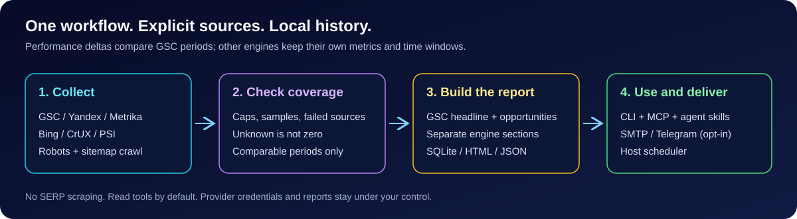

# lv24-seo-optimizer

**Бесплатный SEO-пульт для людей и ИИ-агентов (v0.13.1).**

Собирает Google Search Console, Яндекс.Вебмастер, Яндекс.Метрику, Bing/IndexNow, CrUX и
PageSpeed Insights в одну нормализованную модель, краулит сайт на технические регрессии и отдаёт
это как **письма по расписанию**, **MCP-инструменты**, **CLI** и **скиллы для агентов**.

Платные SEO-платформы не нужны: весь базовый путь работает на бесплатных тарифах.

## Быстрый старт

```bash
uv tool install "lv24-seo[secrets]"
lv24-seo doctor
lv24-seo init --property https://example.com
lv24-seo auth set --provider gsc --stdin   # нужен extra: pip install "lv24-seo[secrets]"
lv24-seo auth set --provider metrika --stdin  # у Метрики отдельный auth-провайдер и токен
lv24-seo gsc query --start 2026-11-01 --end 2026-11-07 --dimensions query,page
lv24-seo yandex indexing --date-from 2026-10-01 --date-to 2026-10-31 --json  # история + appeared/removed
lv24-seo yandex sitemaps --json                 # id, URL, счётчики и ошибки sitemap (read-only)
lv24-seo yandex history --kind sqi --json       # SQI / in-search / queries / query
lv24-seo yandex queue --json                    # задачи recrawl + total провайдера (read-only)
lv24-seo yandex recrawl --url https://example.com/page --allow-write  # план; confirm — POST
lv24-seo report weekly --days 7 --out reports/
lv24-seo report diff --markdown            # разница двух сохранённых недельных снапшотов
lv24-seo stats --days 7 --json             # срез по провайдерам для дашборда
lv24-seo crawl --json                      # проблемы + сверка sitemap ↔ краул
lv24-seo logs analyze --file /var/log/nginx/access.log --json  # боты и доля мусорного обхода
lv24-seo tasks list --json                 # локальный жизненный цикл находок
lv24-seo portfolio list --root "$HOME/sites" --json  # read-only сводка по соседним проектам
mkdir -p backups
lv24-seo backup create --out "$PWD/backups" --json   # zip: конфиг + история SQLite
lv24-seo backup restore --file "$PWD/backups/lv24-seo-backup-<stamp>.zip" \
  --to "$PWD/restored" --json              # новый каталог; текущие файлы не меняются
lv24-seo backup restore --file "$PWD/backups/lv24-seo-backup-<stamp>.zip" \
  --config "$PWD/seo.toml" --json          # план; --allow-write --confirm TOKEN — применить
lv24-seo export skills --out ./skills      # скиллы из wheel-пакета
```

Полный разбор на английском — в [`README.md`](README.md) и
[`docs/guides/quickstart.md`](docs/guides/quickstart.md). Русская версия ниже —
краткая выжимка; при расхождении точен английский текст и `lv24-seo <команда> --help`.



## Что внутри

| Слой | Что даёт |
|---|---|
| Источники | GSC, Вебмастер, Метрика, Bing/IndexNow (страницы, трафик, краул, URL-диагностика, отправка), CrUX, PSI, собственный краул, логи nginx |
| Отчёты | недельный дайджест с дельтами (дельта — только по окнам GSC), атрибутированные изменения (причина/уверенность/доказательства), CWV по шаблонам и устройствам (наполняется `cwv collect`: CrUX URL+устройство, PSI — только lab), триаж индексации, striking distance, деградация контента, техрегрессии |
| MCP | 12 инструментов, 3 ресурса, 3 промпта; без записи к провайдеру по умолчанию — таблица ниже |
| CLI | 25 команды верхнего уровня (18 групп + 7 команд): `version`, `doctor`, `init`, `properties`, `stats`, `crawl`, `install`, `auth`, `config`, `gsc`, `yandex`, `metrika`, `sitemap`, `indexnow`, `bing`, `indexing`, `report`, `cwv`, `schedule`, `export`, `logs`, `tasks`, `backup`, `portfolio`, `mcp` |
| Скиллы | `seo-weekly`, `seo-indexing-triage`, `seo-technical-audit` |
| Автоматизация | cron / systemd timer / Планировщик Windows: `schedule install` по умолчанию только печатает план, запись — с `--allow-write`; `schedule status` только читает; `schedule uninstall` удаляет ровно созданную задачу и идемпотентен; плюс рецепт GitHub Actions |

Планировщик работает по принципу «сначала план»: `lv24-seo schedule install` печатает cron-блок,
systemd-юниты или XML задачи и не пишет ничего без `--allow-write`. `schedule status` показывает
`installed` / `outdated` / `partial` / `missing` / `unknown`, пути и совпадение с текущей
конфигурацией; `schedule uninstall --allow-write` удаляет ровно созданный блок/юниты/задачу,
не трогает чужие cron-строки и при повторном запуске ничего не делает.

## Десктоп

Тот же движок поставляется как **LV24 SEO Optimizer Desktop 0.9.0** — оболочка Tauri v2 с
дашбордом, просмотром недельного отчёта, редактором конфигурации, сценарием «рекомендации →
агенту» и read-only экраном Diagnostics. Она несёт закреплённый сайдкар `lv24-seo` (`0.11.0` в
текущей сборке десктопа), требует движок `>= 0.11.0` и не добавляет собственной логики провайдеров.

| Платформа | Файлы | Автообновление |
|---|---|---|
| Windows 10/11 x64 | NSIS `LV24.SEO.Optimizer_0.9.0_x64-setup.exe` (+ `.exe.sig`), `LV24-SEO-Optimizer_0.9.0_x64-portable.zip` | только NSIS |
| Linux x64 | `LV24.SEO.Optimizer_0.9.0_amd64.AppImage` (+ `.AppImage.sig`), `LV24.SEO.Optimizer_0.9.0_amd64.deb`, `LV24.SEO.Optimizer-0.9.0-1.x86_64.rpm` | только AppImage |
| macOS 13+ arm64/x64 | DMG, `.app.tar.gz` (+ `.sig`) | только `.app` |

deb, rpm и portable ZIP ставятся вручную (MSI не выпускается); у `0.1.0` нет обновлятора. Релизы
публикуют `latest.json` и `SHA256SUMS.txt`.

**Одно хранилище секретов.** Десктоп и CLI используют одну и ту же запись OS-keychain на
провайдера (и на секрет доставки): сервис `lv24-seo`, имена `gsc_token`,
`yandex_webmaster_token`, `yandex_metrika_token`, `bing_api_key`, `crux_api_key`, `psi_api_key`,
`smtp_password`, `telegram_bot_token`. Токен, сохранённый через `lv24-seo auth set` в терминале,
виден в `auth status` десктопа, и наоборот. Переменные `LV24_SEO_*` наследуются процессом CLI
внутри десктопа. Опциональный файловый fallback `<data-dir>/secrets.json` (0600 на POSIX, ACL на
Windows) общий только при одном и том же workspace/data-dir.

Репозиторий десктопа: <https://github.com/LevapVeeskela/lv24-seo-optimizer-desktop>.

### MCP-инструменты

Двенадцать инструментов, три ресурса и три промпта. Десять относятся к чтению: семь инструментов,
доступных только для чтения, не меняют состояние провайдера и локальное состояние; `seo_crawl_site`,
`seo_weekly_report` и `yandex_indexing_state` сохраняют локальные снимки или события индексации,
поэтому у них `readOnlyHint: false` (они не destructive). Два write-инструмента требуют
`allow_write=true`, помечены `destructiveHint: true` и используют тот же двухфазный поток
`plan_hash` / `confirm_token` и `LV24_SEO_WRITE_SECRET`, что и CLI; Bing sitemap submit, Bing
URL submit и Yandex recrawl подключены,
а GSC submit и Bing delete отвечают `WRITE_DISABLED`, ничего не отправляя.

| Инструмент | Тип | `readOnlyHint` | `destructiveHint` | Что делает |
|---|---|---|---|---|
| `seo_properties` | чтение | `true` | `false` | Настроенные провайдеры, цели и наличие токенов |
| `gsc_search_analytics` | чтение | `true` | `false` | Строки GSC по запросам/страницам/странам/устройствам |
| `yandex_query_stats` | чтение | `true` | `false` | Топ запросов Яндекса для хоста |
| `yandex_indexing_state` | чтение + локальное состояние | `false` | `false` | История индексации, события и проблемы; сохраняет события провайдера при наличии хранилища |
| `seo_crawl_site` | чтение + локальное состояние | `false` | `false` | Ограниченный краул; сохраняет страницы и проблемы |
| `seo_weekly_report` | чтение + локальное состояние | `false` | `false` | Недельный дайджест; сохраняет снимок отчёта |
| `seo_report_diff` | чтение | `true` | `false` | Дифф двух сохранённых недельных снимков |
| `seo_log_analysis` | чтение | `true` | `false` | Один локальный nginx JSON-лог: боты по дням и доля мусорного обхода (UA-only) |
| `seo_indexing_triage` | чтение | `true` | `false` | Группирует проблемы индексации в план действий |
| `seo_opportunities` | чтение | `true` | `false` | Striking distance и деградация контента |
| `seo_recrawl_request` | запись | `false` | `true` | Ставит URL в очередь переобхода Яндекса (gated; один POST на URL, не больше остатка дневной квоты) |
| `seo_sitemap_submit` | запись | `false` | `true` | Отправляет sitemap в Bing или GSC (gated; Bing submit подключён, GSC/delete — `WRITE_DISABLED`) |

Ресурсы: `seo://config`, `seo://report/latest`, `seo://docs/tools`. Промпты:
`weekly_seo_review`, `indexing_triage`, `content_opportunities`. Полные входы, выходы и
ограничения — в [`docs/mcp.md`](docs/mcp.md); сгенерированный контракт —
[`schemas/tools.json`](schemas/tools.json).

## Честность данных

- Заголовок недельного отчёта сравнивает только окна GSC; данные Яндекса и сессии Метрики
  показываются отдельно и никогда не суммируются в общую дельту.
- Ошибка одного провайдера не отменяет отчёт: ответ несёт `sources_failed` и `complete: false`.
- Недостигнутая из-за бюджета ссылка — `unvisited`, а не «битая»; редирект в запретную зону
  robots.txt — блокировка, а не находка.
- Сырых архивов ответов провайдеров на диске нет; `raw_retention_days` зарезервирован.

## Статус

Бета (v0.13.1). `0.13.1` — текущий релиз (PyPI, npm и MCP Registry, 2026-11-18): OAuth-коннекторы
для Google Search Console и Yandex Webmaster/Metrika (`auth login`, refresh-токены в keychain,
`--url-only` для desktop), квото-зависимая автоматизация индексации — `indexing status/run/history`,
лимиты Bing/Yandex/IndexNow/GSC и честные счётчики проиндексированного, плюс полная глубина чтения
по платформам (GSC URL
Inspection/sitemap/фильтры, Yandex events/sitemaps/история/очередь recrawl, Bing
page/traffic/crawl/URL/joins, органическая Метрика, CrUX-история и PSI-аудиты). Десктоп `0.9.0` — текущий
релиз десктопа, он несёт движок `0.11.0` и требует `>= 0.11.0`. Открытые честные ограничения: GSC
sitemap submit и Bing sitemap delete отвечают `WRITE_DISABLED` (Bing sitemap/URL submit, IndexNow
и Yandex recrawl реально отправляют),
`crawl.concurrency` зарезервирован (краулер последовательный с `Crawl-delay`), анализ логов
определяет ботов только по User-Agent, `portfolio list` и `backup restore` доступны только в CLI,
а CWV-секция строится лишь по сохранённым field-данным CrUX/PSI. GSC принимает OAuth-коннектор,
обычный access token и JSON-ключ service account (файл читается один раз за процесс, access token
обновляется автоматически). `0.9.0` — предыдущий релиз: Bing sitemap submit и one-click
IndexNow; `0.8.0` — до него: writer CWV по URL и устройству, безопасный
`backup restore --to`, планировщик с явным `--allow-write`. Новое в 0.13.1 — в
[`docs/releases/0.13.1.md`](docs/releases/0.13.1.md); новое в 0.13.0 — в
[`docs/releases/0.13.0.md`](docs/releases/0.13.0.md); новое в 0.12.2 — в
[`docs/releases/0.12.2.md`](docs/releases/0.12.2.md); новое в 0.12.1 — в
[`docs/releases/0.12.1.md`](docs/releases/0.12.1.md); новое в 0.12.0 — в
[`docs/releases/0.12.0.md`](docs/releases/0.12.0.md); новое в 0.11.0 — в
[`docs/releases/0.11.0.md`](docs/releases/0.11.0.md); новое в 0.10.0 — в
[`docs/releases/0.10.0.md`](docs/releases/0.10.0.md); новое в 0.9.0 — в
[`docs/releases/0.9.0.md`](docs/releases/0.9.0.md); новое в 0.8.0 — в
[`docs/releases/0.8.0.md`](docs/releases/0.8.0.md); новое в 0.7.0 — в
[`docs/releases/0.7.0.md`](docs/releases/0.7.0.md).

## Для агентов

Начните с [`AGENTS.md`](AGENTS.md). Машиночитаемые файлы: `schemas/tools.json`, `llms.txt`,
`skills/*/SKILL.md`.

## Лицензия

Apache-2.0. Данные Google/Яндекса принадлежат владельцу ресурса; проект их не перепродаёт.
