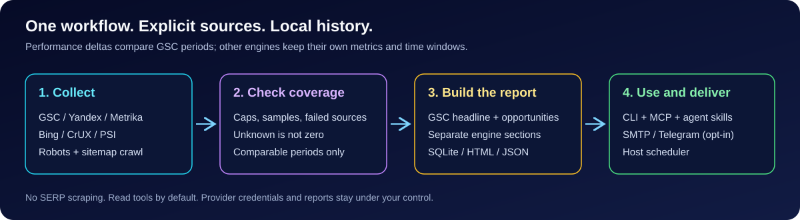

# lv24-seo-optimizer

**Бесплатный SEO-пульт для людей и ИИ-агентов (v0.3.1).**

Собирает Google Search Console, Яндекс.Вебмастер, Яндекс.Метрику, Bing/IndexNow, CrUX и
PageSpeed Insights в одну нормализованную модель, краулит сайт на технические регрессии и отдаёт
это как **письма по расписанию**, **MCP-инструменты**, **CLI** и **скиллы для агентов**.

Платные SEO-платформы не нужны: весь базовый путь работает на бесплатных тарифах.

## Быстрый старт

```bash
uv tool install "lv24-seo[secrets]"
lv24-seo doctor
lv24-seo init --property https://example.com
lv24-seo auth set --provider gsc --stdin   # нужен extra: pip install "lv24-seo[secrets]"
lv24-seo gsc query --start 2026-11-01 --end 2026-11-07 --dimensions query,page
lv24-seo report weekly --days 7 --out reports/
lv24-seo report diff --markdown            # разница двух сохранённых недельных снапшотов
lv24-seo crawl --json                      # проблемы + сверка sitemap ↔ краул
lv24-seo export skills --out ./skills      # скиллы из wheel-пакета
```

Полный разбор на английском — в [`README.md`](README.md) и
[`docs/guides/quickstart.md`](docs/guides/quickstart.md). Русская версия ниже —
краткая выжимка; при расхождении точен английский текст и `lv24-seo <команда> --help`.



## Что внутри

| Слой | Что даёт |
|---|---|
| Источники | GSC, Вебмастер, Метрика, Bing/IndexNow, CrUX, PSI, собственный краул, логи nginx |
| Отчёты | недельный дайджест с дельтами (дельта — только по окнам GSC), триаж индексации, striking distance, деградация контента, техрегрессии |
| MCP | 11 инструментов, 3 ресурса, 3 промпта; по умолчанию только чтение |
| CLI | `init`, `doctor`, `auth`, `gsc`, `yandex`, `crawl`, `report`, `schedule`, `export`, `mcp serve` |
| Скиллы | `seo-weekly`, `seo-indexing-triage`, `seo-technical-audit` |
| Автоматизация | cron / systemd timer / Планировщик Windows, рецепт GitHub Actions |

## Честность данных

- Заголовок недельного отчёта сравнивает только окна GSC; данные Яндекса и сессии Метрики
  показываются отдельно и никогда не суммируются в общую дельту.
- Ошибка одного провайдера не отменяет отчёт: ответ несёт `sources_failed` и `complete: false`.
- Недостигнутая из-за бюджета ссылка — `unvisited`, а не «битая»; редирект в запретную зону
  robots.txt — блокировка, а не находка.
- Сырых архивов ответов провайдеров на диске нет; `raw_retention_days` зарезервирован.

## Статус

Бета (v0.3.1). Открытые честные ограничения: OAuth-токен GSC (service account — позже),
`sitemap submit` / `recrawl` отвечают `WRITE_DISABLED` (IndexNow реально отправляет),
`crawl.concurrency` зарезервирован (краулер последовательный с `Crawl-delay`).

## Для агентов

Начните с [`AGENTS.md`](AGENTS.md). Машиночитаемые файлы: `schemas/tools.json`, `llms.txt`,
`skills/*/SKILL.md`.

## Лицензия

Apache-2.0. Данные Google/Яндекса принадлежат владельцу ресурса; проект их не перепродаёт.
